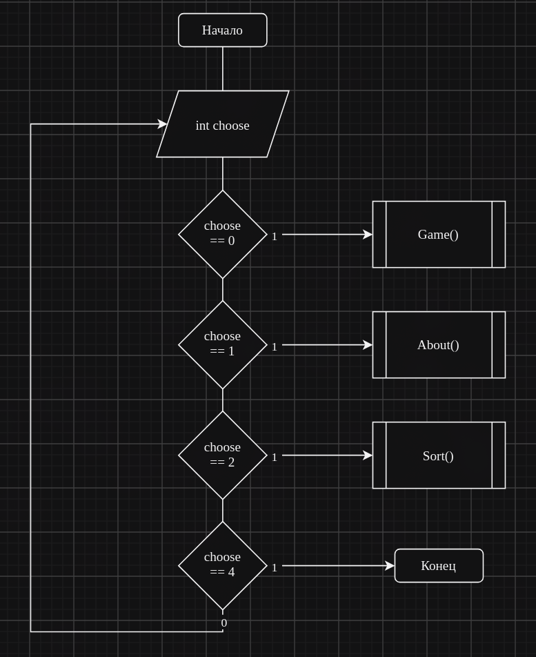
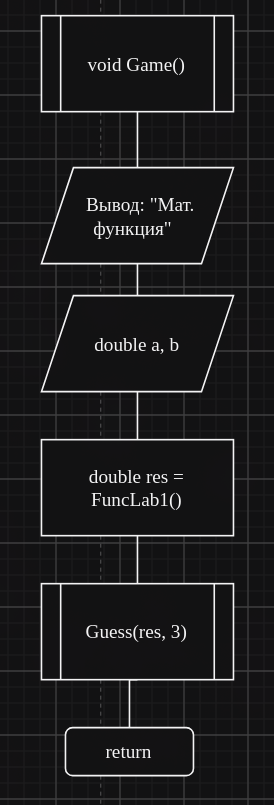
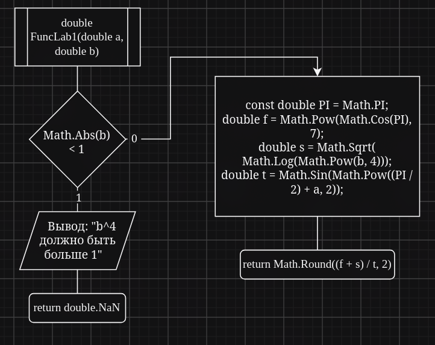
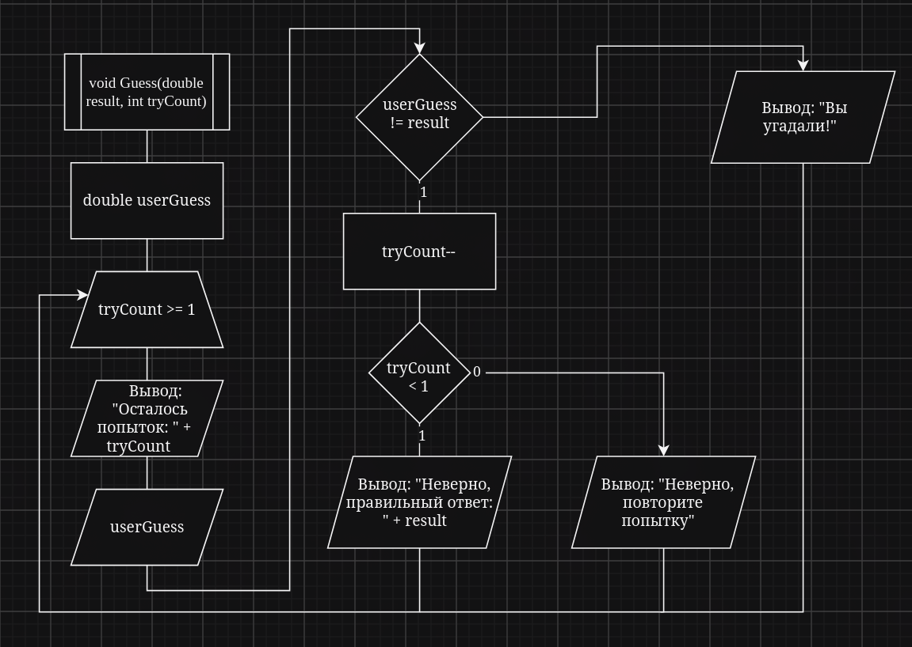
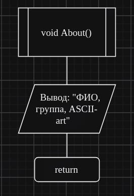
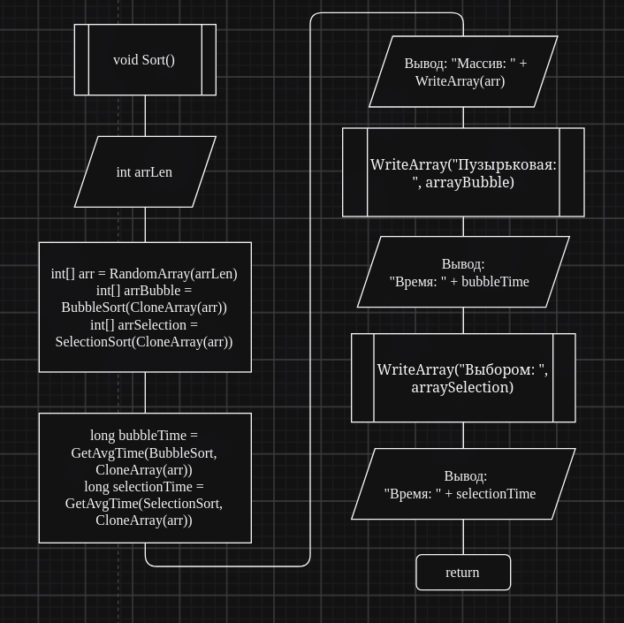
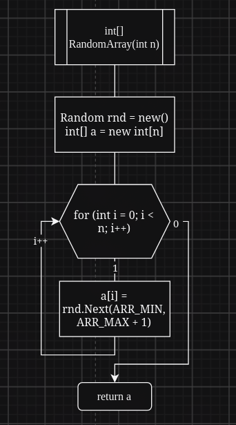
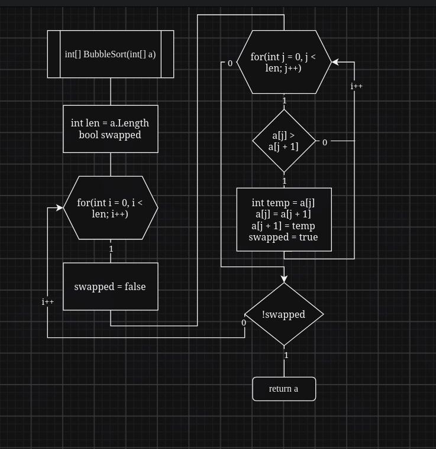
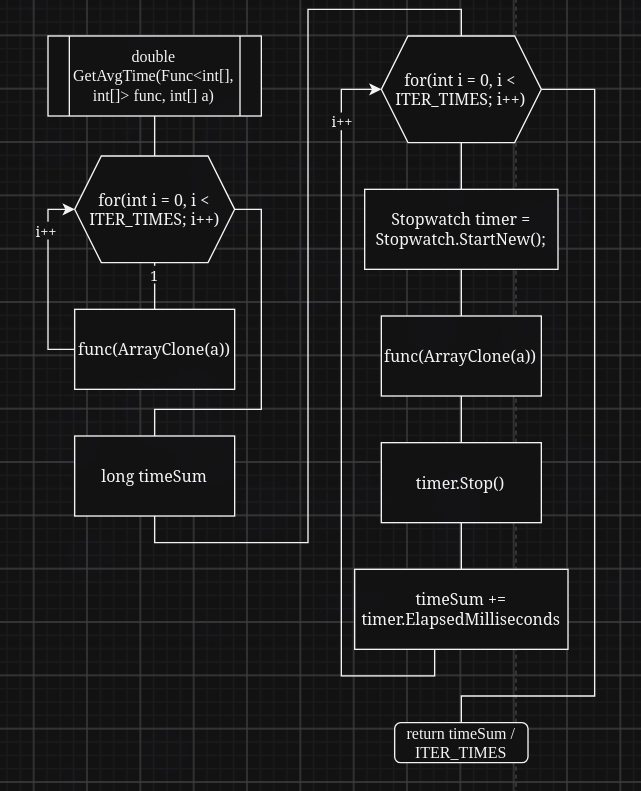
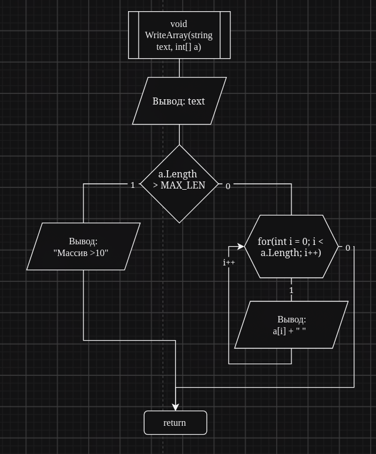

# Лабораторная работа №3

Пахомов Максим 6101-090301D

Программа содержит в себе модули с игрой "Отгадай ответ", информацией об авторе и сравнением производительности массивов.

---

## Функционал  

### Меню

Передвижение по меню осуществляется при помощи стрелок(`UpArrow`, `DownArrow`) и клавиши `Enter`.



### 1. Отгадай ответ

* Формула: $$f = \frac{\cos^7(\pi) + \ln(b^4)}{\sin^2(\left(\frac{\pi}{2} + a\right))}$$



* Ход работы:
    1. Пользователь вводит $a$ в градусах и $b$.
    2. Программа вычисляет результат функции.
    
    3. Запускается логика мини-игры.
        * Пользователю предлагается ввести предполагаемое значение $f(a,b)$.
        * У него есть 3 попытки.
        * После 3 неправильных вводов мини-игра завершается и выводится верное значение $f(a,b)$.
        * Если пользователь угадывает, выводится `Вы угадали!`.

    

### 2. Об авторе

Выводит имя, фамилию, номер группы и ASCII-art.



### 3. Сортировка массива



* Пользователь вводит длину массива.
* Генерируется массив случайных чисел в диапазоне от `-1000` до `1000` (по умолчанию, конфигурируется константами)

    
* К этому массиву применяются 2 алгоритма сортировки:
    1. Пузырьковая (Bubble sort)

        
    2. Выбором (Selection sort)
* Замеряется среднее время выполнения сортировок (по умолчанию 10) при помощи `Stopwatch`.

    
* Если длинна массива не превышает 10 (по умолчанию), он выводится на экран, иначе выводится сообщение о том, что массив слишком длинный.

    

### 4. Выход

Запрос подтверждения выхода из программы (`д`/`н`).

---

## Сборка и запуск

### Требования

* [.NET 10 SDK](https://dotnet.microsoft.com/) (или выше)

### Запуск

```bash
git clone https://github.com/liriks47/ssau-osnovi-lab3.git
cd ssau-osnovi-lab3
dotnet run
```

Для компиляции одиночного исполняемого файла

### Linux

```bash
dotnet publish -c Release -r linux-x64 --self-contained true -p:PublishSingleFile=true -p:PublishReadyToRun=true -p:PublishTrimmed=true
```

### Windows

```bash
dotnet publish -c Release -r win-x64 --self-contained true -p:PublishSingleFile=true -p:PublishReadyToRun=true -p:PublishTrimmed=true

```
